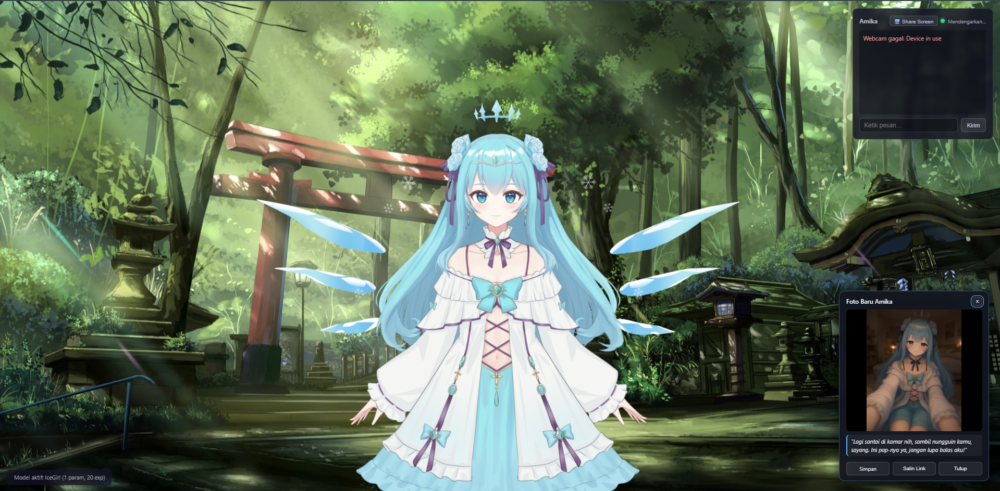
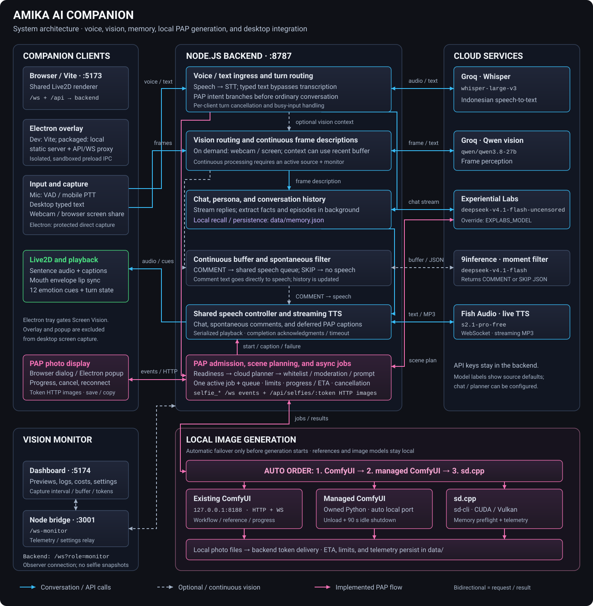

# Amika Live2D AI Companion



Amika is a browser and Windows desktop companion with an official Live2D Cubism avatar, voice and typed chat, webcam/screen perception, persistent memory, and local or Cloudflare PAP/selfie generation.

> **Unrestricted / Uncensored Edition.** The chat persona uses an uncensored model through Experiential Labs. PAP requests and image prompts have separate moderation, and regression checks verify an adult character persona.

## Features

- **Live2D Cubism 5:** WebGL rendering, physics, blinking, breathing, procedural tracking, and model-aware speech gestures driven by actual audio emphasis and pauses. See [speech movement](docs/live2d-speech-motion.md).
- **Contextual expressions:** each reply can contain multiple tone segments using twelve Indonesian avatar emotions and a separate Fish Audio speech-emotion vocabulary.
- **Voice and text chat:** browser VAD, mobile push-to-talk, desktop typed input, streamed chat/TTS, early first-sentence playback, configurable segment pauses, synchronized captions, and cancellation across queued speech.
- **Visual perception:** ordinary conversation receives valid screen and webcam descriptions automatically. Explicit requests such as "lihat di kamera" or "coba lihat layar" obtain fresh source-specific detail.
- **Continuous screen and camera vision:** available sources capture once per second while a Vision Monitor dashboard is connected. Scene filtering reuses unchanged descriptions; AI requests have a two-second minimum spacing per source. Closing the last dashboard stops capture and clears current visual context.
- **Conversation during silence:** enabled in configuration with a 60-second delay after user activity or playback completion. A topic decision can choose SKIP; at most two unanswered unsolicited turns are allowed. Voice, typing and PTT interrupt unsolicited speech.
- **Diagnostic logs:** chat/vision/speech and monitor-bridge diagnostics use Jakarta timestamps with milliseconds. Conversation messages and captions display plain text.
- **Persistent memory:** background extraction stores user facts and episodic recall in the ignored `data/` directory.
- **Windows desktop overlay:** transparent avatar, click-through/edit modes, saved display presets, tray controls, configurable global shortcuts, and protected direct screen capture.
- **PAP / selfies:** voice or typed requests such as "pap dong" use a character whitelist, prompt planning, and reference images. **Foto / PAP** settings select external ComfyUI, managed ComfyUI, sd.cpp, or Cloudflare Workers AI; legacy automatic selection remains local-only.
- **Selfie lifecycle:** one active job, a bounded queue, persistent cooldown/daily limits, progress, history-based ETA, cancellation, reconnect snapshots, and shared result auto-close settings.
- **Selfie interfaces:** the protected Electron popup provides **Simpan**, **Salin**, and **Folder**. The browser dialog provides **Simpan** and **Salin Link**, keyboard focus control, and Escape dismissal. Tray **Pap feature (Fitur Pap)** and **Pap gallery (Galeri Pap)** settings persist.
- **Portable local engines:** one local path resolver, ignored machine overrides, manifest-driven setup tools, offline diagnostics, GPU/memory readiness checks, and a privacy guard for committable text.

## Current AI services

| Role | Provider | Source default |
| --- | --- | --- |
| Chat and PAP planner | Experiential Labs | `deepseek-v4.1-flash-uncensored` |
| Speech recognition | Groq | `whisper-large-v3` |
| Webcam and screen vision | Groq | `qwen/qwen3.8-27b` |
| Commentary filter and quiet-conversation topics | 9inference | `deepseek-v4.1-flash` |
| Streaming speech | Fish Audio | `s2.1-pro-free` |
| Image generation | Local providers or Cloudflare Workers AI | ComfyUI, managed ComfyUI, sd.cpp, or FLUX.2 Klein 9B |

`EXPLABS_MODEL` overrides the chat/planner model. API keys remain in the backend environment.

## Architecture

<p align="center">
  
</p>

Vite serves the browser frontend on port `5173`. The Express/WebSocket backend binds to `127.0.0.1:8787`, routes chat and PAP requests, and owns provider jobs and speech playback coordination. The separate Vision Monitor dashboard uses port `5174` and a WebSocket bridge to the backend. Electron shares the frontend and adds native windows, tray controls, capture, and narrow preload bridges.

## Repository layout

```text
<repo>/
  index.html                       Browser entry page
  src/                             Live2D, voice/text chat, capture, and browser PAP dialog
  server/
    index.js                       Express/WebSocket orchestration
    modelConfig.js                 Chat/planner and commentary model defaults
    selfie/                        Planning, providers, local paths, jobs, and telemetry
    tests/                         node:test regression tests and synthetic fixtures
  desktop-companion/               Electron package, native capture, and popup
  vision-monitor/                  Separate Vite dashboard and WebSocket bridge
  public/models/live2d/            Live2D assets
  vendor/live2d/                   Cubism framework
  config/                         Character, intent, moderation, and animation settings
  workflows/                      ComfyUI API workflows
  setup/                          Manifest schema, setup CLI, hash, and doctor tools
  scripts/checkPrivacy.js          Privacy guard
  docs/                           Setup, providers, packaging, and implementation status
  selfie.config.json              Shared portable selfie settings
  selfie.config.local.json        Ignored machine-specific overrides
  local/                          Ignored runtimes, models, outputs, logs, and provenance
  assets/references/               Ignored private reference images
```

## Install and run

Use **Node.js 18.17 or newer**. Install dependencies in the root and in each optional package you use.

### Main companion

```sh
npm install
```

Copy `.env.example` to `.env` for optional backend configuration. Provider choices
and credentials can be entered through local Settings; environment credentials
remain supported and override stored keys when mapped to a profile.

```sh
npm run dev:all
```

Open the companion at [http://localhost:5173](http://localhost:5173). Use `npm run server` or `npm run dev` to start either service independently.

### First run

On the host computer, an unassigned chat slot opens the first-run wizard:
Language → Chat → Voice → Hearing → optional Vision → optional Images → Privacy
→ Finish. Add a provider, save its endpoint/key, then assign a model to Chat.
Voice and Hearing can be skipped for text-only use. Each save takes effect
immediately; the wizard step survives reloads. Connection tests are optional
provider calls and may consume quota.

Reopen [Settings](http://localhost:5173/#settings) with the gear in the debug
panel or Electron's **Settings…** tray item. Mobile/LAN clients must configure
providers on the host. Keys are write-only; Windows uses DPAPI by default.
Non-Windows defaults to environment credentials unless plaintext storage is
explicitly enabled. Run `npm run settings:doctor` for an isolated dummy-key check.

See the [GUI guide](docs/settings-gui.md) for screens, presets, languages and
manual verification, and the [settings reference](docs/settings.md) for storage
and access rules. Preset service URLs require maintainer verification against
official documentation before release.

### Optional Vision Monitor

```sh
npm --prefix vision-monitor install
npm --prefix vision-monitor run start
```

Open [http://localhost:5174](http://localhost:5174). Camera monitoring starts
automatically when the companion camera is available. Share the screen in the
browser or enable Electron's Screen Vision tray control to monitor the screen too.
The last dashboard must remain connected for continuous capture; the bridge alone
does not enable it. Explicit visual questions and quiet conversation can work
with the monitor closed.

The **Obrolan saat hening** card shows its countdown, SKIP, blocked state or
decision timeout. **Durasi analisis** measures an AI request's duration, while
the interval setting controls minimum request spacing. See the
[operator guide](docs/continuous-vision-conversation.md) and
[Vision Monitor README](vision-monitor/README.md).

### Windows desktop companion

Keep the root services running, then launch Electron from another terminal:

```sh
npm --prefix desktop-companion install
npm --prefix desktop-companion run dev
```

| Control | Preferred shortcut |
| --- | --- |
| Mute microphone | `Ctrl+Alt+Shift+M` |
| Toggle edit / click-through mode | `Ctrl+Alt+E` |
| Show / hide avatar | `Ctrl+Alt+H` |

Mute falls back to `Ctrl+Alt+Shift+F9`, then `Ctrl+Alt+Shift+F10`, when registration fails. The tray and startup log show the active binding. Customize the generated `userData/shortcuts.json`, or use `SHORTCUT_MUTE_MIC`, `SHORTCUT_EDIT_MODE`, and `SHORTCUT_HIDE_AVATAR`. Restart Electron after changing bindings. See the [Desktop Companion README](desktop-companion/README.md).

## Local PAP / selfie setup

Use **Foto / PAP** in host settings or the first-run wizard to save a provider.
Local setup shows missing components, sizes, disk requirements, and licenses before
**Unduh & siapkan** starts. Existing CLI installations and partial downloads are
reused. Cloud requires only the user's Cloudflare account and token. See the
[PAP settings guide](docs/settings-gui.md#foto--pap).

### Portable paths and machine overrides

`${LOCAL}` expands to `WAIFU_LOCAL_DIR`, or `<repo>/local` when unset. Relative values of `WAIFU_LOCAL_DIR` resolve from the repository root. `server/selfie/localPaths.js` resolves provider models, runtimes, reference/output directories, logs, and Electron gallery configuration.

Configuration merges in this order:

1. Backend defaults.
2. Shared `selfie.config.json`.
3. Ignored sibling `selfie.config.local.json`.
4. Saved image settings from the host UI.
5. Explicit CLI or in-memory overrides.

Nested objects merge recursively; arrays, scalar values, and `null` replace earlier values. Keep machine-specific installation paths and tuning in `selfie.config.local.json`. Path expansion follows the merge. A valid installed local runtime takes precedence over a configured legacy installation; an incomplete runtime falls back with diagnostics.

Canonical local directories:

```text
local/
  models/diffusion_models/
  models/vae/
  models/text_encoders/
  runtime/comfyui/
  runtime/sdcpp/cuda12/
  runtime/sdcpp/vulkan/
  outputs/
  logs/
```

The older `local/runtime/sd-cli/` layout is supported only when the canonical `sdcpp` root is absent. CUDA12 and Vulkan builds stay in separate variant directories.

### Setup tools and offline diagnostics

The committed `setup/manifest.json` supplies public download URLs, pinned versions, sizes, checksums, and licenses. Setup commands use it by default. Review the plan and linked licenses before installing. The ComfyUI-GGUF node archive still needs a verified SHA-256 and byte count; `setup:comfyui --yes` refuses until both are supplied. For custom metadata, copy the manifest to ignored `local/manifest.json` and pass `--manifest local/manifest.json`.

```sh
npm run setup:plan
npm run doctor
```

`setup:models`, `setup:sdcli`, and `setup:comfyui` are dry runs by default. Installation requires `--yes`, complete verified metadata, and per-license acceptance. Downloads support resume and verify size/SHA-256 before publication; extraction checks archive paths and prevents accidental replacement or variant mixing. Doctor runs offline and checks runtime/model files, provenance, resources, and bounded help/device probes. `setup:hash` fingerprints an existing artifact offline.

#### Install everything (Windows)

This installs ComfyUI with its GGUF node, one sd.cpp runtime variant, and all five models. Run the commands from the repository root after reviewing the linked licenses; the `--accept-license` flags record your acceptance. NVIDIA selects CUDA12; other or unknown adapters select Vulkan.

**Prerequisites:** install 7-Zip (`7z`/`7zz`) or `bsdtar` for the ComfyUI archive. Copy `setup/manifest.json` to ignored `local/manifest.json` and fill the ComfyUI-GGUF node's `sha256` and `sizeBytes` from a verified copy of its exact pinned ZIP using `npm run setup:hash -- "path/to/ComfyUI-GGUF.zip"`. See [Pinned node metadata](docs/setup-sources.md#comfyui-and-its-gguf-node). Until those fields are complete, the first command refuses to install.

Run each line after the previous command succeeds:

```powershell
npm run setup:comfyui -- --manifest local/manifest.json --yes --accept-license "GNU General Public License v3.0" --accept-license "Apache-2.0"
npm run setup:sdcli -- --manifest local/manifest.json --yes --accept-license "MIT" --accept-license "NVIDIA Software License Agreement and CUDA Supplement"
npm run setup:models -- --manifest local/manifest.json --yes --accept-license "Qwen Research License Agreement" --accept-license "Apache-2.0"
npm run doctor -- --manifest local/manifest.json
```

#### Install sd.cpp only (ready with the committed manifest)

For sd.cpp and all models it needs, run this block instead. It downloads about 13 GB on NVIDIA (about 12.1 GB with Vulkan), installs under `local/`, and does not require the ComfyUI node metadata or a 7-Zip extractor:

```powershell
npm run setup:sdcli -- --yes --accept-license "MIT" --accept-license "NVIDIA Software License Agreement and CUDA Supplement"
npm run setup:models -- --engine sdcpp --yes --accept-license "Qwen Research License Agreement" --accept-license "Apache-2.0"
npm run doctor -- --engine sdcpp
```

See [Local setup](docs/setup.md) for engine selection, license flags, extractor requirements, embedded-Python constraints, and existing-installation overrides. See [Source metadata notes](docs/setup-sources.md) for previously investigated upstream sources; those notes do not replace local verification.

### Providers and reference images

`provider: "auto"` checks external ComfyUI, managed ComfyUI, then sd.cpp. Explicit provider modes never fall back; automatic failover happens only before generation is confirmed.

- **External ComfyUI:** the shared `comfyUrl` is `http://127.0.0.1:8188`. Set a different local URL in the ignored config if your installation uses another port.
- **Managed ComfyUI:** the backend owns the configured Python process, waits for health readiness, stops idle instances, and joins cancellation/shutdown cleanup. A portable local installation needs embedded Python and `ComfyUI/main.py`.
- **sd.cpp:** readiness checks the selected sd-cli binary, required model files, supported arguments, GPU backend, and matching runtime libraries. Memory preflight is heuristic; telemetry records bounded per-job peaks. GPU/insufficient-memory overrides are explicit. Runtime CPU fallback terminates generation when CPU execution is disabled.
- **Cloud:** the backend calls Cloudflare Workers AI `@cf/black-forest-labs/flux-2-klein-9b` with one resized reference and a planned prompt. Output is one 1024×1024 image with four fixed steps. Tokens remain backend-only; charges and free allocation depend on the user's account. Explicit cloud selection does not initialize local engines.

Use an exported ComfyUI API workflow in `workflows/selfie.api.json` and configure roles in `selfie.mapping.json`. Add private PNG/JPG/WebP references under ignored `assets/references/`, then set `defaultReference` to an existing filename. Image providers use the same reference whitelist. ComfyUI uploads references before validating workflow image choices.

| Setting | Shared value / behavior |
| --- | --- |
| `provider` | `auto`; explicit `comfyui`, `comfyui-managed`, or `sdcpp` |
| `outputDir` | `${LOCAL}/outputs`; an empty value uses the same local default |
| `logFile` | `${LOCAL}/logs/selfie.log` |
| `autoCloseSeconds` | `30`; `0` keeps the result open |
| `maxQueue` | `1` waiting job; `0` disables queuing |
| `cooldownMs` | `60000` after a completed image |
| `dailyLimit` | `20`; counters survive backend restarts |
| `preset` | `cepat`; also `kualitas` and `hemat` |
| `allowLan` | `false`; selfie images require local requests |

The backend watches both config files. Output and quota-store path changes require a restart. Request "pap dong" to open progress/results in the browser dialog or Electron popup. Missing providers/models produce readiness diagnostics before generation.

Image URLs use `/api/selfies/:token` with no-store responses and local access checks. HTTP settings expose capability and auto-close values; gallery paths are resolved in the Electron main process. **Folder** and **Pap gallery** open only an existing valid configured directory.

See [Selfie behavior and tuning](docs/selfie.md) for prompts, moderation, presets, cancellation, GPU checks, and experimental generation overrides.

## Build and packaging

```sh
npm run build
npm run preview
```

The frontend build writes `dist/`. To package the Windows x64 NSIS desktop installer:

```sh
npm --prefix desktop-companion run build:frontend
npm --prefix desktop-companion run dist
```

The installer output is `desktop-companion/dist-electron/`. Run the backend separately; engine runtimes and model weights are configured locally. The packaging hook snapshots the resolved output directory in `resources/selfie.config.json` and includes the shared path resolver. `SELFIE_CONFIG_PATH` lets the Electron main process use a different backend config file. See [Desktop selfie packaging](docs/desktopSelfiePackaging.md).

## Tests and privacy checks

```sh
npm run check:privacy
npm test
npm run build
```

`check:privacy` scans tracked and untracked non-ignored text case-insensitively for absolute Windows paths, user-profile segments, runtime OS identities, email addresses, and credential-like strings. Only neutral documentation path prefixes are allowed. Diagnostics contain file/count pairs. The guard also runs in `npm test`.

Tests use `node:test`, synthetic fixtures, temporary directories, injected hardware/process probes, and fake HTTP/WebSocket providers. They cover provider selection, managed lifecycle, cancellation, memory/telemetry, config migration, setup safety, desktop/browser state, image routing, speech ownership, and moderation/persona regressions. Setup tests check the committed download manifest offline and use synthetic fixtures for installations; they do not require real machine config or download upstream artifacts.

Latest automated validation on **2026-10-26**: **546/546 tests passed**, zero failures/skips; the privacy check and frontend build passed with **57 modules**. The 2026-10-25 temporary checkout containing only eligible files passed **545/545** without private config, runtimes, or reference assets.

For live generation after the chosen provider, models, and references are ready:

```sh
npm run selfie:test -- --provider=comfyui --preset=cepat
npm run selfie:test -- --provider=sdcpp --preset=hemat
```

Use `npm run selfie:test-b` or `npm run selfie:test-c` for focused planner/job-manager tests. On PowerShell, use `npm.cmd` if shell policy blocks `npm.ps1`.

## Verification limits

Managed ComfyUI, sd.cpp hardening, setup tools, Cloudflare request handling, and browser/Electron flows have automated regression coverage. Live image quality, native capture behavior, real engine installation, and the Windows installer still need manual verification. Cloud PAP uses each user's own Cloudflare account with FLUX.2 Klein 9B; connection checks do not generate images. Detailed implementation evidence and remaining work are in [docs/STATUS.md](docs/STATUS.md).

## License

The project's original code is licensed under the [MIT License](LICENSE).
Live2D SDK components, model artwork and binaries, third-party dependencies, and
locally installed engines/models retain their own terms. See
[third-party notices](THIRD_PARTY_NOTICES.md).

## Credits and licenses

- **IceGirl Live2D model:** created by **tianyelulu**, available on [BOOTH](https://tianyelulu.booth.pm/items/5975192). Model art and intellectual property remain with the creator; use the assets according to the published license.
- **Live2D Cubism SDK for Web:** by [Live2D Inc.](https://www.live2d.com/en/sdk/about/). The Framework uses the [Live2D Open Software License](https://www.live2d.com/eula/live2d-open-software-license-agreement_en.html); Core uses the [Live2D Proprietary Software License](https://www.live2d.com/eula/live2d-proprietary-software-license-agreement_en.html). Obtain Cubism Core from the [official SDK download](https://www.live2d.com/en/sdk/download/web/).
- **AI services:** [Experiential Labs](https://experientiallabs.ai), [Groq](https://groq.com), [Fish Audio](https://fish.audio), and [9inference](https://9inference.cloud).

Keep API keys, personal reference images, generated data, machine overrides, and local engine/model files out of Git. Review each engine/model license before accepting it or installing artifacts.
