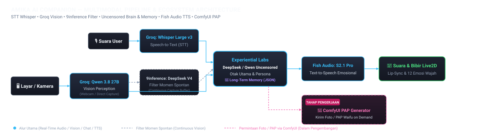

# Amika — Live2D AI Companion (Unrestricted / Uncensored Edition)

> **[UNRESTRICTED / UNCENSORED EDITION]**
> Edisi ini menggunakan profil kepribadian **Unrestricted** dan ditenagai oleh model LLM **Uncensored (`Qwen3.8 Flash Next Uncensored`)** yang disediakan oleh **xplabs.ai (Experiential Labs)**, sehingga percakapan bersama Amika berjalan bebas tanpa batasan sensor standar.
>
> Fitur PAP memiliki moderasi tersendiri untuk permintaan foto dan prompt gambar, serta pengujian regresi untuk memastikan persona menyebut usia dewasa.

Aplikasi AI companion interaktif berbasis browser dan desktop yang menghadirkan karakter **Amika** dalam bentuk avatar **Live2D Cubism** resmi. Dilengkapi percakapan suara hands-free berlatensi rendah (*Voice-to-Voice*) maupun input teks desktop, animasi natural multi-layer (*synthetic face tracking*, *audio-reactive body sway*, *sentence-break clips*), 12 ekspresi emosi kontekstual, persepsi visual cerdas kamera/webcam & layar, pemantauan layar (*continuous screen vision*) dengan filter spontan berkala, serta permintaan foto **PAP / Selfie** melalui ComfyUI lokal.

---

## 🌟 Fitur Utama

1. **Unrestricted Persona & Uncensored Brain LLM (via xplabs.ai)**:
   - Otak percakapan utama menggunakan model **`Qwen3.8 Flash Next Uncensored` (`qwen3.8-flash-next-uncensored`)** dari penyedia API **xplabs.ai (Experiential Labs)**.
   - Kepribadian Amika dikonfigurasi secara *unrestricted* & intim sebagai istri virtual yang ekspresif, manja, playful, dan responsif tanpa filter penolakan kaku.
   - Streaming JSON terurut (`{"emotion":"...","text":"..."}`) dengan `reasoning_effort: "none"` untuk mengirim emosi ke avatar sebelum kalimat pertama selesai di-generate.

2. **Avatar Live2D Cubism 5.0 (Model IceGirl)**:
   - Rendering WebGL resmi dengan physics controller dinamis (gerakan rambut, aksesoris, dan gaun).
   - Animasi pernapasan (*breathing*) dan kedipan mata (*auto-blink*) kontinu.
   - **Synthetic Face Tracking**: Simulasi gerakan kepala (*yaw/pitch/roll*), *eye gaze saccade & fixation*, dan mikro-gerakan alis menggunakan *Simplex Noise* prosedural ala VTube Studio.
   - **Multi-Layer Talking Animation**:
     - *Layer 1 (Audio-Reactive)*: Asymmetric EMA smoothing menggerakkan badan dan kepala mengikuti irama suara TTS secara organik.
     - *Layer 2 (Sentence-Break Clips)*: Memicu gerakan transisi halus di jeda kalimat berdasarkan intensitas emosi.

3. **Sistem Emosi Terstruktur (12 Emosi)**:
   - LLM secara terstruktur menentukan ekspresi emosi bahasa Indonesia: `terkejut`, `marah`, `bingung`, `jengkel`, `malu`, `kesal`, `sedih`, `kagum`, `sayang`, `jahil`, `penasaran`, dan `netral`.
   - Mengubah file ekspresi `.exp3.json` Live2D secara otomatis saat berbicara.

4. **Percakapan Real-Time Hands-Free (STT → LLM → TTS) & Input Ketik Desktop**:
   - **STT (Groq Whisper Large v3 Turbo)**: Deteksi suara otomatis via Web Audio VAD di browser (serta *Press-and-Hold* di mobile), dilengkapi prompt kontekstual dan penyaringan noise non-suara.
   - **Desktop Text Chat Input**: Kolom input teks khusus tampilan desktop di bawah log percakapan yang terhubung langsung ke pipeline LLM + Vision + TTS yang sama.
   - **LLM Streaming (`qwen3.8-flash-next-uncensored` via xplabs.ai)**: Menghasilkan respons uncensored secara streaming per kalimat.
   - **TTS Streaming (Fish Audio)**: Streaming chunk MP3 per kalimat langsung ke Web Audio API untuk meminimalkan delay ke audio pertama (*Time-to-First-Audio*).
   - **Pemulihan percakapan**: Kegagalan sebagian TTS tetap menunggu audio sebelumnya selesai diputar; respons atau error dari giliran lama diabaikan. Status sibuk mengikuti penerima suara, dan penolakan input mengembalikan status UI sesuai keadaan server.

5. **Persepsi Visual Cerdas (Smart Webcam vs Screen Routing)**:
   - Mendeteksi intent permintaan lihat visual dan otomatis memilih tepat satu sumber:
     - **Webcam**: Saat user meminta melihat kamera/wajah atau menunjukkan benda fisik (*"lihat di kamera"*, *"ini benda apa?"*).
     - **Screen/Layar**: Saat user membahas layar/game/monitor (*"coba lihat layar/game aku"*).
   - **Smart Routing dengan Vision Monitor**:
     - Jika **Vision Monitor menyala**, permintaan melihat layar langsung menggunakan buffer deskripsi terbaru (instan tanpa API call ganda).
     - Jika **Vision Monitor mati**, vision dieksekusi secara *one-shot* langsung di tempat menggunakan **Qwen 3.8 27B** (Groq).

6. **Conditional Streaming Vision & Spontaneous Commentary**:
   - Pemantauan layar kontinu (1 FPS) hanya aktif ketika *Share Screen* dan **Vision Monitor** sama-sama menyala (otomatis berhenti saat Vision Monitor ditutup untuk menghemat resource).
   - Buffer in-memory dievaluasi secara periodik oleh **DeepSeek V4 Flash**: jika ada momen menarik, Amika langsung berceletuk secara spontan (*spontaneous commentary*) lengkap dengan suara TTS dan animasi avatar.

7. **Mobile Responsive & Camera Toggle**:
   - Layout Picture-in-Picture (PiP) adaptif untuk tampilan mobile dengan video kamera full-screen sebagai background, interaksi *press-and-hold* di area UI, dan tombol toggle kamera depan/belakang (*user* vs *environment*).

8. **Vision Monitor (Standalone Observer Panel)**:
   - Aplikasi dashboard terpisah bergaya StreamingVLM untuk memantau feed layar, membaca log deskripsi visual secara live, melihat kartu evaluasi filter, memantau running cost, serta mengatur interval capture secara remote.

9. **Personalisasi Long-Term Memory & Episodic Conversation Recall**:
   - Sistem memori jangka panjang persisten (`data/memory.json`) yang mencatat fakta, kebiasaan, panggilan, dan topik obrolan sebelumnya secara otomatis di latar belakang tanpa menghambat latensi respons.

10. **Native Desktop Companion (Electron Floating Overlay)**:
    - Aplikasi desktop Windows pendamping dengan avatar Live2D transparan melayang tanpa border/kotak hitam.
    - Dilengkapi *System Tray*, dua preset tampilan (*Dengan Sayap* vs *Tanpa Sayap*), *Click-Through & Mode Edit* (`Ctrl+Alt+E`), *Mute Mic* (`Ctrl+Alt+M`), dan *Direct Screen Capture* tanpa popup izin browser dengan proteksi DWM `WDA_EXCLUDEFROMCAPTURE` (avatar tidak ikut terfoto).

11. **PAP / Selfie Sesuai Permintaan (ComfyUI Lokal)**:
    - **Permintaan suara atau teks**: Ucapkan atau ketik *"pap dong"*, *"minta foto"*, atau *"selfie"*. LLM menyusun adegan dari whitelist karakter, lalu ComfyUI menghasilkan gambar berdasarkan referensi lokal. Permintaan dan prompt akhir diperiksa oleh moderasi.
    - **Job asinkron**: Satu job aktif dengan antrean terbatas, progress, ETA dari riwayat durasi, cooldown, dan batas harian persisten. ETA ditampilkan sebagai belum diketahui ketika riwayat belum tersedia.
    - **Popup desktop**: Satu jendela terlindungi dari tangkapan layar mengikuti posisi avatar dan perubahan monitor. Kartu menyesuaikan ruang yang tersedia, memulihkan ukuran setelah diperbesar/diperkecil, serta menjaga caption dan tombol tetap dapat dijangkau dengan scroll.
    - **Aksi desktop**: **Simpan** membuka dialog Save As, **Salin** menyalin gambar ke clipboard native, dan **Folder** membuka direktori foto. System Tray menyediakan **Pap feature (Fitur Pap)** dengan pilihan tersimpan per companion serta **Pap gallery (Galeri Pap)**.
    - **Dialog browser**: Menampilkan progress dan hasil dengan **Simpan** untuk mengunduh gambar serta **Salin Link** untuk menyalin URL. Fokus keyboard tetap berada dalam dialog; Escape menutupnya dan mengembalikan fokus ke kontrol sebelumnya.
    - **Sambung ulang dan pembatalan**: Snapshot server memulihkan job/hasil atau membersihkan tampilan yang sudah tidak berlaku. Tombol **Batal** menunggu hasil pembatalan dari server; foto tetap ditampilkan jika proses selesai lebih dahulu.
    - **Tutup otomatis**: `autoCloseSeconds` dari backend berlaku untuk popup desktop dan dialog browser; nilai bawaan 30 detik, sedangkan `0` mempertahankan hasil tetap terbuka.

---

## 🏛️ Arsitektur Sistem

<p align="center">
  
</p>

Diagram SVG masih memuat label pengembangan PAP lama. Diagram teks dan bagian Status & Roadmap di bawah menjelaskan implementasi terbaru.

```
┌────────────────────────────────────────────────────────────┐
│         Browser / Desktop Companion (Electron)             │
│  - Live2D Canvas (IceGirl) & Web Audio Analyser            │
│  - Hands-Free VAD / Mobile PTT + Desktop Text Chat Input   │
│  - Camera & Direct Desktop Capture (WDA_EXCLUDEFROMCAPTURE)│
│  - Popup PAP Electron / Dialog PAP Browser               │
└─────────────────────────────▲──────────────────────────────┘
                              │ WebSocket (/ws)
┌─────────────────────────────▼──────────────────────────────┐
│                Node.js Server Orchestrator                 │
│  - Brain LLM: Qwen3.8 / DeepSeek Uncensored (xplabs.ai)    │
│  - STT Proxy: Whisper Large v3 (Groq)                      │
│  - Vision Perception: Qwen 3.8 27B (Groq)                  │
│  - Spontaneous Filter: DeepSeek V4 Flash (9inference)      │
│  - TTS Streamer: Fish Audio S2.1 Pro                       │
│  - Long-Term Memory & Episodic Recall (data/memory.json)   │
│  - Planner PAP, Moderasi & Generator ComfyUI Lokal         │
│  - Antrean Job, Progress/ETA & Snapshot Sambung Ulang       │
└─────────────────────────────▲──────────────────────────────┘
                              │ WebSocket (/ws?role=monitor)
┌─────────────────────────────▼──────────────────────────────┐
│            Vision Monitor App (Port 3001/5174)             │
│  - Live Stream Push Preview & Sync Countdown               │
│  - Realtime Vision Log Feed & Cost Tracker                 │
│  - Remote Config Slider (Interval Capture, Buffer, Tokens) │
└────────────────────────────────────────────────────────────┘
```

Perkembangan PAP dikirim lewat WebSocket; gambar diambil melalui HTTP lokal dengan URL token `/api/selfies/:token`. Caption hasil menunggu giliran avatar selesai berbicara sebelum dibacakan.

---

## 🛠️ Tech Stack & Powered By

- **Frontend Avatar**: Vanilla JavaScript, Vite, HTML5 Canvas, WebGL, Web Audio API, Official Live2D Cubism Core & Framework 5.0.
- **Backend Server**: Node.js, Express, `ws` (WebSocket Server).
- **Desktop**: Electron dengan electron-builder untuk installer Windows x64 (NSIS).
- **Generator Gambar**: ComfyUI lokal melalui backend, dengan workflow API dan gambar referensi.
- **AI Services & API Providers**:
  - **[xplabs.ai (Experiential Labs)](https://experientiallabs.ai)**: Penyedia API utama untuk **Brain LLM Uncensored** (`qwen3.8-flash-next-uncensored`).
  - **[Groq](https://groq.com)**: Speech-to-Text inference ultra-cepat (`whisper-large-v3-turbo`) dan Multimodal Vision (`qwen/qwen3.8-27b`).
  - **[Fish Audio](https://fish.audio)**: Neural Speech Synthesis & real-time streaming TTS.
  - **[9inference](https://9inference.cloud)**: Evaluasi filter berkala untuk komentar spontan (`deepseek-v4-flash-0731`).

---

## 📦 Struktur Folder

```
my waipu/
├── index.html                   # Halaman utama companion (Live2D avatar + chat panel + desktop text input)
├── package.json                 # Dependencies companion utama
├── vite.config.js               # Konfigurasi Vite (Port 5173)
├── .env.example                 # Template environment variables
├── selfie.config.json           # Provider, folder foto, antrean, cooldown, preset, tutup otomatis
├── selfie.mapping.json          # Pemetaan node dan field workflow ComfyUI
├── config/                      # Kata kunci PAP, whitelist karakter, dan moderasi
├── workflows/selfie.api.json    # Workflow ComfyUI hasil ekspor API
├── server/                      # Backend Orchestrator
│   ├── index.js                 # Entry point Express & WebSocket server (/ws)
│   ├── experientialClient.js    # OpenAI-compatible client ke xplabs.ai (Experiential Labs)
│   ├── llmChat.js               # Streaming chat Uncensored & structured JSON parser
│   ├── personality.js           # System prompt Amika (Unrestricted Edition, 12 emosi)
│   ├── modelConfig.js           # Konfigurasi model ID (Qwen3.8 Flash Next Uncensored & Filter)
│   ├── streamingVisionManager.js# Pipeline vision kontinu & filter spontan
│   ├── visionCapture.js         # Smart routing intent vision (screen vs webcam)
│   ├── sttTranscribe.js         # STT Groq Whisper + noise filter
│   ├── ttsGenerate.js           # TTS Fish Audio streaming
│   ├── speechController.js      # Kepemilikan giliran dan sinkronisasi pemutaran suara
│   ├── selfie/                  # Planner, provider, antrean job, rute gambar, dan kontrol fitur
│   │   └── tests/               # Uji regresi selfie, desktop/browser, HTTP/WS, dan suara
│   ├── groqClient.js            # Groq SDK instance (STT & Vision)
│   ├── nineInferenceClient.js   # OpenAI client ke 9inference.cloud (Vision Filter)
│   └── voiceConfig.js           # Konfigurasi referensi suara TTS
├── src/                         # Frontend Avatar & Logika Browser
│   ├── main.js                  # Setup Live2D, resize canvas, lip-sync loop
│   ├── live2dCompanion.js       # Live2D model controller, layers, & motion manager
│   ├── syntheticTracking.js     # Simplex noise procedural face & eye tracking
│   ├── expressionMap.js         # Mapping 12 emosi ke file .exp3.json & intensitas
│   ├── speechPlayback.js        # Antrean audio dan status giliran percakapan
│   ├── browserSelfieModal.js     # Dialog PAP dengan kontrol fokus dan pemulihan job
│   └── companion.js             # VAD/PTT audio, desktop text chat, screen share, & WS client
├── public/                      # Static Assets
│   └── models/live2d/           # Asset model Live2D IceGirl (.moc3, textures, .exp3, .motion3)
├── desktop-companion/           # [Native App] Windows Companion (Electron + Tray + Direct Capture)
│   ├── package.json             # Electron & electron-builder packaging config
│   ├── src/main/                # Main process (Tray, Window, Capture Service, Security)
│   ├── src/preload/             # Context isolation preload bridge
│   ├── src/popup/selfiePopup.html # UI popup PAP desktop
│   └── scripts/packageSelfieConfig.js # Hook snapshot folder foto saat packaging
├── docs/                        # Dokumentasi & Diagram Arsitektur SVG
│   ├── architecture-pipeline.svg# Diagram alur visual multimodal & ecosystem
│   ├── selfie.md                # Setup workflow dan perilaku PAP
│   ├── desktopSelfiePackaging.md # Konfigurasi galeri pada aplikasi terpasang
│   └── STATUS.md                # Status implementasi dan batas verifikasi
└── vision-monitor/              # [Standalone App] Observer & Remote Config Panel
    ├── index.html               # UI dashboard StreamingVLM
    ├── package.json             # Dependencies terpisah
    ├── vite.config.js           # Port 5174
    ├── src/                     # UI scripts & sinkronisasi state
    └── server/                  # WebSocket bridge (?role=monitor) ke companion utama
```

---

## 🚀 Panduan Setup & Menjalankan

### 1. Prasyarat

- **Node.js**: Versi 18 atau lebih baru.
- **API Keys**:
  - `EXPLABS_API_KEY`: API key dari **[xplabs.ai (Experiential Labs)](https://experientiallabs.ai)** untuk model `qwen3.8-flash-next-uncensored`.
  - `GROQ_API_KEY`: Dapatkan di [console.groq.com](https://console.groq.com/keys) untuk STT & Vision.
  - `FISH_API_KEY`: Dapatkan di [fish.audio](https://fish.audio) untuk TTS.
  - `NINEINFERENCE_API_KEY`: Dapatkan di [9inference.cloud](https://9inference.cloud) untuk filter komentar spontan.

### 2. Setup Project Utama

1. Clone repositori dan install dependencies:
   ```bash
   npm install
   ```

2. Buat file `.env` dari template:
   ```bash
   cp .env.example .env
   ```
   Pastikan konfigurasi `.env` Anda berisi:
   ```env
   EXPLABS_API_KEY=xpl_your_api_key_here

   GROQ_API_KEY=your_groq_key_here
   FISH_API_KEY=your_fish_key_here
   NINEINFERENCE_API_KEY=your_9inference_key_here
   ```

3. Jalankan server backend dan Vite frontend secara bersamaan:
   ```bash
   npm run dev:all
   ```
   Aplikasi utama akan berjalan di:
   - **Frontend Companion**: `http://localhost:5173`
   - **Backend Server**: `http://localhost:8787`

### 3. Menjalankan Vision Monitor (Opsional / Terpisah)

Jika ingin membuka panel observer & mengaktifkan fitur *Continuous Interval Capture* (1 FPS):
```bash
cd vision-monitor
npm install
npm run start
```
Buka Vision Monitor di: **`http://localhost:5174`**

### 4. Menjalankan Desktop Companion (Windows)

Biarkan backend dan frontend dari `npm run dev:all` berjalan, lalu buka terminal lain di root proyek:

```bash
npm --prefix desktop-companion install
npm --prefix desktop-companion run dev
```

Avatar tampil sebagai overlay desktop. Klik ikon System Tray untuk mengatur **Pap feature (Fitur Pap)** atau membuka **Pap gallery (Galeri Pap)**. Pilihan fitur tersimpan dan diterapkan kembali saat koneksi tersambung ulang. Panduan kontrol lengkap tersedia di [README Desktop Companion](desktop-companion/README.md).

### 5. Menyiapkan PAP / Selfie

1. Jalankan ComfyUI beserta model yang dibutuhkan workflow. Atur `comfyUrl` dalam `selfie.config.json`: konfigurasi repo memakai `http://127.0.0.1:8188`; ComfyUI Desktop biasanya memakai port `8000`.
2. Ekspor workflow dengan **Workflow > Export (API)** ke `workflows/selfie.api.json`, lalu sesuaikan node dan field di `selfie.mapping.json`.
3. Tambahkan gambar referensi PNG/JPG/WebP ke `assets/references/` dan isi `defaultReference` sesuai nama file. Simpan gambar pribadi secara lokal.
4. Jalankan ulang backend setelah mengubah konfigurasi. Ucapkan atau ketik **"pap dong"**; progress muncul di popup Electron atau dialog browser. Jika provider tidak terjangkau, permintaan ditolak dengan pesan yang menjelaskan penyebabnya.

Pengaturan utama pada `selfie.config.json`:

| Pengaturan | Nilai bawaan / perilaku |
|---|---|
| `provider` | `comfyui`, generator gambar lokal |
| `outputDir` | Kosong memakai `~/Pictures/WaifuSelfies`; menerima path absolut, relatif terhadap root proyek, atau diawali `~` |
| `autoCloseSeconds` | `30` detik; `0` menonaktifkan tutup otomatis hasil |
| `maxQueue` | `1` job menunggu selain satu job aktif; `0` menonaktifkan antrean |
| `cooldownMs` | `60000` milidetik setelah foto selesai |
| `dailyLimit` | `20` foto; penghitung disimpan agar tidak hilang saat backend dimulai ulang |
| `preset` | `cepat`; tersedia juga `kualitas` |
| `allowLan` | `false`; akses gambar dibatasi ke localhost |

**Folder** dan **Pap gallery** membuka direktori foto dari konfigurasi lokal yang sudah ada. File biasa, direktori yang belum ada, serta symlink/junction yang mengalihkan lokasi akan ditolak. Proses utama Electron membaca konfigurasi folder secara lokal. Endpoint `/api/selfies/settings` hanya mengirim `enabled` dan `autoCloseSeconds` serta memerlukan permintaan lokal dengan metadata origin yang sesuai. `enabled` menyatakan kemampuan server; toggle fitur berlaku per koneksi companion.

Rincian workflow, mapping, referensi, dan perilaku pembatalan tersedia di [Panduan Selfie](docs/selfie.md).

### 6. Build Frontend dan Installer Desktop

Setelah dependensi root dan desktop terpasang, jalankan dari root proyek:

```bash
npm --prefix desktop-companion run build:frontend
npm --prefix desktop-companion run dist
```

Frontend dikompilasi ke `dist/`; electron-builder menghasilkan installer Windows x64 NSIS di `desktop-companion/dist-electron/`. Backend dan ComfyUI tetap dijalankan terpisah; kredensial API berada di backend.

Hook `afterPack` menyimpan snapshot konfigurasi lokal yang hanya berisi `outputDir` ke `resources/selfie.config.json`. Path relatif mempertahankan root backend saat packaging; path home/default diselesaikan untuk pengguna aplikasi terpasang. Jika aplikasi terpasang perlu membaca konfigurasi backend terbaru, tetapkan **`SELFIE_CONFIG_PATH`** ke path absolut file konfigurasi sebelum meluncurkan Electron. Pengaturan ini dibaca oleh proses utama Electron. Lihat [Packaging Selfie Desktop](docs/desktopSelfiePackaging.md).

### 7. Pengujian dan Validasi

Jalankan pengujian otomatis dengan provider AI/gambar tiruan dan build frontend dari root proyek:

```bash
npm test
npm run build
```

Pengujian mencakup planner, antrean dan pembatalan job, HTTP/WebSocket, popup desktop, dialog browser, sambung ulang, settings tanpa path filesystem, packaging konfigurasi galeri, serta pemulihan giliran dan audio. Guard moderasi mensyaratkan minimal **80 frasa terlarang unik** dan menolak contoh permintaan/prompt terblokir; guard persona mensyaratkan usia karakter **minimal 18 tahun** dan menolak penyebutan usia di bawah 18.

Verifikasi terakhir pada `7ebfdec`: **213/213 pengujian lulus**, tanpa gagal atau skip; `npm run build` berhasil dengan **57 modul**. Pengujian memakai provider tiruan; generasi AI/ComfyUI langsung, alur aplikasi langsung, dan installer masih memerlukan verifikasi.

Untuk menguji satu generasi gambar langsung setelah ComfyUI, workflow, model, dan referensi siap:

```bash
npm run selfie:test -- --provider=comfyui --preset=cepat
```

Uji langsung mencetak durasi dan lokasi hasil. Untuk menguji planner atau job manager secara terpisah, gunakan `npm run selfie:test-b` atau `npm run selfie:test-c`. Di PowerShell, gunakan `npm.cmd` jika eksekusi `npm.ps1` diblokir oleh kebijakan shell.

---

## 🙏 Credits & Attribution

1. **Model Live2D — IceGirl**:
   - Dibuat oleh **tianyelulu** dan tersedia secara gratis di [BOOTH (IceGirl Model)](https://tianyelulu.booth.pm/items/5975192).
   - Model ini digunakan sebagai aset visual avatar dalam proyek companion ini sesuai dengan lisensi penggunaan yang diberikan oleh kreator di halaman BOOTH tersebut. Seluruh hak cipta, desain karakter, dan hak kekayaan intelektual model Live2D tetap menjadi milik kreator aslinya (**tianyelulu**). Proyek ini tidak mengklaim kepemilikan atas model tersebut.

2. **Live2D Cubism SDK for Web**:
   - Teknologi rendering Live2D ditenagai oleh [Live2D Cubism SDK for Web](https://www.live2d.com/en/sdk/about/) resmi dari **Live2D Inc.**
   - Penggunaan Live2D Cubism Core dan Framework tunduk pada [Live2D Open Software License Agreement](https://www.live2d.com/eula/live2d-open-software-license-agreement_en.html) dan Live2D Proprietary License.
   - *Catatan bagi pengembang yang meng-clone proyek ini:* Pastikan untuk mengunduh pustaka Live2D Cubism Core resmi secara langsung dari situs [Live2D Cubism SDK for Web](https://www.live2d.com/en/sdk/download/web/) untuk kepatuhan lisensi.

3. **Layanan Pihak Ketiga & Infrastruktur**:
   - **[xplabs.ai (Experiential Labs)](https://experientiallabs.ai)** untuk penyediaan API model bahasa uncensored (`Qwen3.8 Flash Next Uncensored`).
   - **[Groq](https://groq.com)** untuk inferensi LPU Speech-to-Text & Vision berkecepatan tinggi.
   - **[Fish Audio](https://fish.audio)** untuk sintesis suara waifu yang ekspresif.
   - **[9inference](https://9inference.cloud)** untuk evaluasi filter momen spontan.

---

## 📌 Status & Roadmap

- [x] Official Live2D Cubism 5.0 integration dengan physics & expressions.
- [x] Synthetic procedural face tracking (Simplex noise).
- [x] Multi-layer talking animations (procedural sway + sentence break clips).
- [x] 12 Indonesian emotion classification system.
- [x] Ultra low-latency STT (Groq Whisper) dengan anti-hallucination filtering.
- [x] **Unrestricted / Uncensored LLM Chat** via **xplabs.ai** (`Qwen3.8 Flash Next Uncensored` / `DeepSeek V4.1 Flash Uncensored`).
- [x] Desktop text chat input box terintegrasi dengan pipeline suara & vision.
- [x] Streaming TTS audio playback & synchronized lip-sync (Fish Audio).
- [x] Smart vision routing (Webcam vs Screen Share + Vision Monitor buffer integration).
- [x] Conditional 1 FPS screen monitoring & periodic spontaneous commentary.
- [x] Standalone Vision Monitor observation panel with live remote configuration.
- [x] **Personalisasi long-term memory & episodic conversation recall** (`data/memory.json`, background auto-extract worker, time-aware greetings).
- [x] **Direct desktop capture integration via native tray companion** (Electron transparent floating overlay, click-through & mode edit, system tray controls, global shortcuts, DWM content protection `WDA_EXCLUDEFROMCAPTURE`, tanpa browser share screen prompt).
- [x] **PAP / Selfie sesuai permintaan** — Planner dengan whitelist dan moderasi, provider ComfyUI lokal, antrean terbatas, progress/ETA, pembatalan, cooldown, dan batas harian persisten telah diimplementasikan dan diuji dengan provider tiruan.
- [x] **UI PAP desktop dan browser** — Popup terlindungi dengan Simpan/Salin/Folder, toggle tray tersimpan, pemulihan layout dan sambung ulang, tutup otomatis, serta dialog browser dengan kontrol fokus keyboard.
- [x] **Keamanan dan regresi PAP** — URL gambar bertoken, respons no-store, konfigurasi folder lokal, validasi pengirim IPC/navigasi, dan guard moderasi/persona.
- [x] **Konfigurasi packaging selfie** — Hook `afterPack` untuk snapshot `outputDir` dan override lokal `SELFIE_CONFIG_PATH`.
- [ ] **Verifikasi langsung** — AI/ComfyUI, alur browser/Electron dan tangkapan layar, serta instalasi Windows x64 masih perlu diuji langsung.
- [ ] **Provider alternatif** — sd.cpp belum diverifikasi dari awal hingga akhir; provider cloud belum diimplementasikan.

Status terperinci dan batas verifikasi tersedia di [docs/STATUS.md](docs/STATUS.md).
